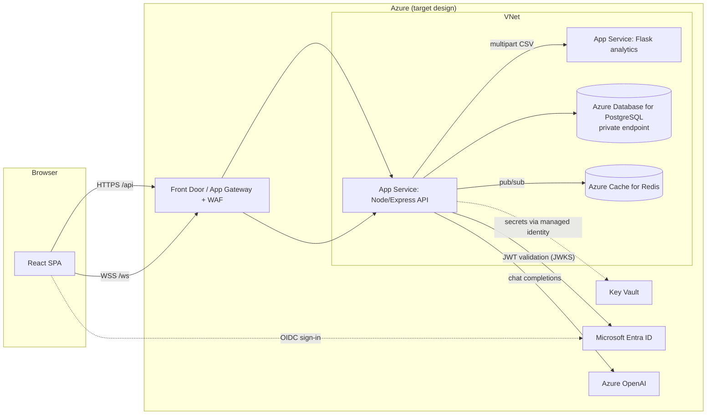
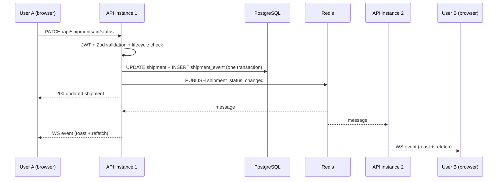

# Architecture

## Request flow: updating a shipment status

## Backend layering

`routes → validate (Zod) → controller → service → repository → Prisma`

| Layer | Responsibility |
|---|---|
| routes | URL map, auth, rate limits, Zod validation |
| controllers | HTTP in/out only (status codes, actor identity) |
| services | Business rules: lifecycle transitions, uniqueness, notifications, AI orchestration |
| repositories | All Prisma queries; soft-delete filter lives here so it cannot be forgotten |
| middleware | auth, validation, central error mapping (Zod/Prisma/Multer → JSON errors) |

Error format everywhere: `{ "error": { "code", "message", "details?" } }`.

## Module notes

- **AI assistant** — retrieval step injects live totals and any tracking numbers found in the message into a delimited `<context>` block. The system prompt restricts scope, forbids invention, and tells the model to treat context as data (prompt-injection defence). History: last 20 messages per `sessionId` from PostgreSQL. Provider selection: Azure OpenAI → OpenAI → offline demo responder. One retry on 429/5xx, 20 s timeout, clean 502 for the UI.
- **Analytics** — validates headers/types/size, drops bad rows (and reports how many), returns Plotly JSON for browser rendering plus optional Kaleido PNGs (`?png=true`, or `/analyze/png` for a ZIP).
- **WebSockets** — token passed on the upgrade request (`/ws?token=`), verified with the same logic as HTTP. 30 s ping/pong heartbeat; Redis pub/sub for multi-instance fan-out; client reconnects with exponential backoff.
