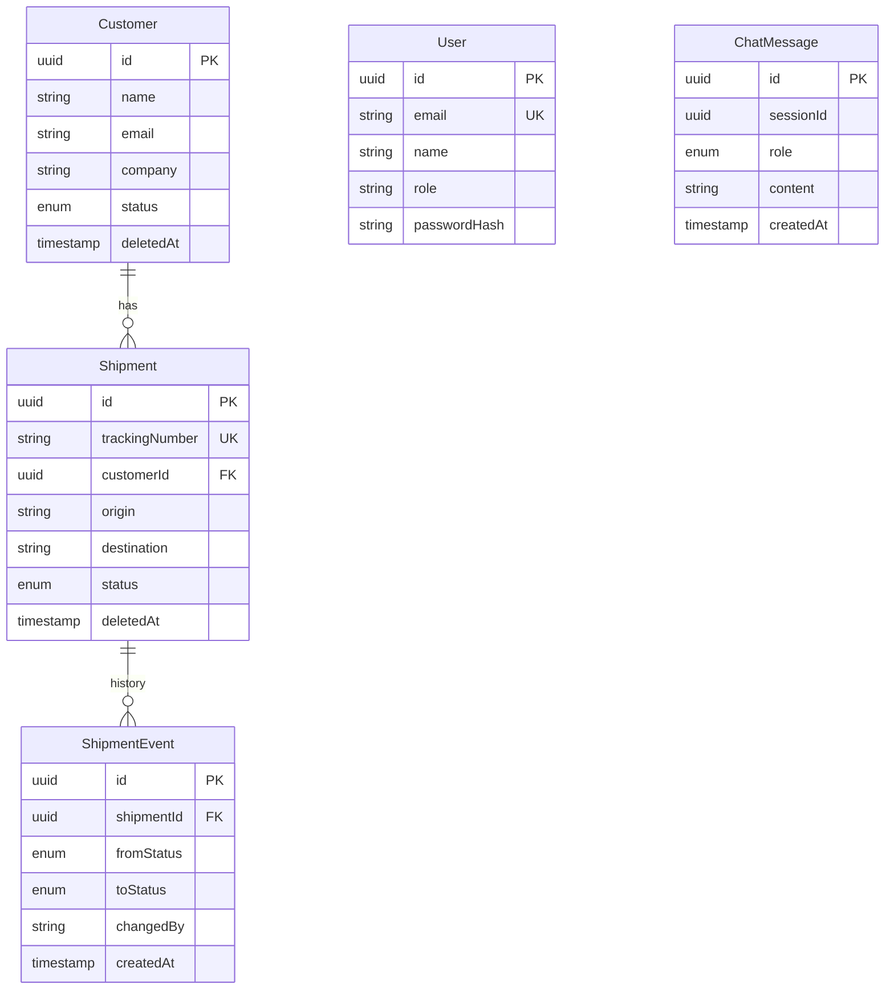

# Database schema (PostgreSQL via Prisma)

Source of truth: `backend/prisma/schema.prisma`. Migration: `backend/prisma/migrations/20260101000000_init`.



## Conventions

| Concern | Approach |
|---|---|
| Soft delete | `deletedAt` (+ `deletedBy` on customers). Repositories always filter `deletedAt IS NULL`. Deleting a customer also sets `status = Inactive`. |
| Audit fields | `createdAt`, `updatedAt`, `createdBy`, `updatedBy` (actor email from the JWT). |
| Email uniqueness | Partial unique index `lower(email) WHERE deletedAt IS NULL`, so a deleted customer's email can be reused. Prisma can't express this natively, so it lives in the SQL migration. |
| Status history | Append-only `ShipmentEvent`, written in the same transaction as the status change. This is also the natural CDC/export table for Fabric. |
| Referential integrity | `Shipment.customerId → Customer` is `ON DELETE RESTRICT`; soft delete keeps history intact. |
| Indexes | `Shipment(customerId)`, `Shipment(status)`, `Customer(status)`, `ChatMessage(sessionId, createdAt)`. |

## Migration commands

```bash
npx prisma migrate dev --name <change>   # create + apply in development
npx prisma migrate deploy                # apply in CI/CD and production (also run by the Docker image on boot)
```
