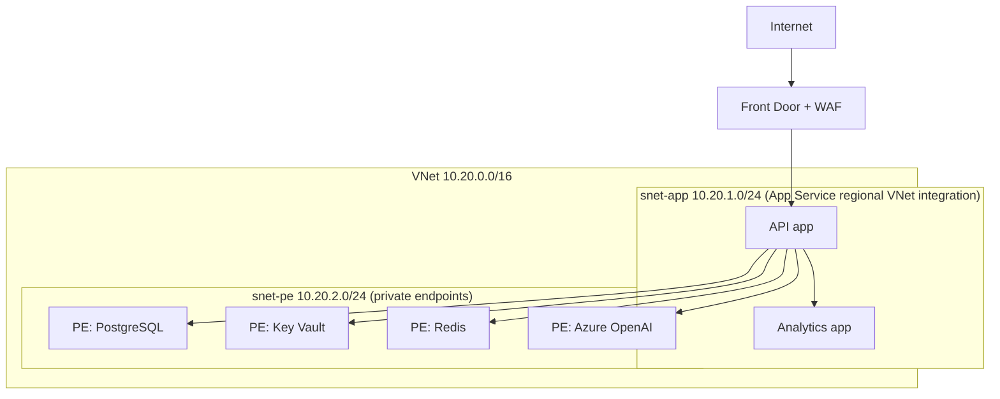

# Module 6 – Azure deployment design

Actual deployment is not required by the brief; this is the target design, with the repo already shaped for it (Dockerfiles, `prisma migrate deploy` on boot, `/api/health`, graceful shutdown, `.github/workflows/deploy-azure.yml`).

## 1. Components

| Concern | Azure service | Notes |
|---|---|---|
| API | **App Service** (Linux, container, P1v3) | Always On, WebSockets enabled, 2+ instances, staging slot |
| Analytics | App Service (second app, same plan) | Internal only: reachable from the API through the VNet, no public ingress |
| Frontend | Static Web Apps *or* Storage static website behind Front Door | SPA with `/index.html` fallback |
| Database | **Azure Database for PostgreSQL – Flexible Server** | Zone-redundant HA, PITR 14–35 days, private access only |
| Cache / fan-out | Azure Cache for Redis | Pub/sub for WebSocket events across instances |
| Identity | **Microsoft Entra ID** | App registrations: SPA (auth code + PKCE) and API (exposes `access_as_user`, app roles `Admin`, `Operator`) |
| Secrets | **Key Vault** | Referenced from App Service settings: `@Microsoft.KeyVault(SecretUri=…)` |
| AI | Azure OpenAI | Accessed with managed identity (role *Cognitive Services OpenAI User*) |
| Edge | Front Door Premium + WAF | TLS, WAF OWASP rules, rate limiting, custom domain |
| Observability | Application Insights + Log Analytics | Structured pino logs, request IDs, alerts |

## 2. Networking

- **VNet integration**: outbound traffic from App Service goes through `snet-app`; `WEBSITE_VNET_ROUTE_ALL=1`.
- **Private endpoints** (optional discussion item, recommended for production): PostgreSQL, Key Vault, Redis and Azure OpenAI have public network access disabled; private DNS zones (`privatelink.postgres.database.azure.com`, `privatelink.vaultcore.azure.net`, …) are linked to the VNet.
- Inbound restriction: App Service access restrictions allow only the Front Door service tag + `X-Azure-FDID` header match.

## 3. Authentication with Entra ID

1. SPA signs in with **MSAL.js** (authorization code + PKCE) and requests the API scope.
2. SPA sends the access token as `Authorization: Bearer` (and in `/ws?token=`).
3. API runs with `AUTH_MODE=entra`: verifies signature (JWKS), issuer, audience, expiry — implemented in `middleware/auth.ts` using `jose`.
4. Roles come from the `roles` claim (app roles) and map to the `role` on `req.user`.

Switching modes needs configuration only: `AUTH_MODE=entra`, `ENTRA_TENANT_ID`, `ENTRA_AUDIENCE`. Replacing the login form with MSAL is the remaining frontend step.

## 4. Secrets management

- Secrets in Key Vault: `DATABASE-URL`, `JWT-SECRET` (mock mode only), `REDIS-URL`, and any third-party keys.
- App Service has a **system-assigned managed identity** with `Key Vault Secrets User` — no credentials in config, repo or CI.
- Prefer passwordless PostgreSQL with Entra authentication (managed identity token as the DB password) once the Prisma connection is wrapped to refresh tokens; until then keep the password in Key Vault and rotate every 90 days (Event Grid → rotation function).
- Azure OpenAI is called with the managed identity in production; API keys are only a local-dev fallback.

## 5. Deployment strategy

- Build container images in CI → Azure Container Registry.
- Deploy to the **staging slot**, run `prisma migrate deploy` (the image does it at startup; for risky migrations use a pre-swap job), smoke-test `/api/health`, then **swap slots** (zero downtime, instant rollback by swapping back).
- Migrations follow *expand → migrate → contract* so the old and new versions can both run during a swap.
- Environments: `dev`, `staging`, `prod` in separate resource groups; infrastructure as code with Bicep/Terraform.
- Scaling: App Service autoscale on CPU > 65 % and HTTP queue length; Flask service scales independently (CPU bound).

## 6. Security considerations

| Area | Control |
|---|---|
| Transport | HTTPS only, TLS 1.2+, HSTS (Helmet), WSS for sockets |
| AuthN/Z | Entra ID tokens, role claims, least-privilege app roles |
| Input | Zod validation on every body/query/param; 5 MB upload cap; CSV type/column validation |
| Abuse | Login rate limit (20/15 min), chat rate limit (30/min), WAF rules at the edge |
| Browser | Strict CORS allow-list, Helmet headers, no secrets in the SPA |
| Data | Private endpoints, encryption at rest (platform-managed keys, CMK optional), soft delete + audit fields, PITR backups |
| Logging | No tokens/passwords in logs, request IDs for tracing |
| Supply chain | Locked dependencies, `npm audit` / Dependabot, container image scanning in ACR |
| AI | Scoped system prompt, retrieved data delimited and marked as data, length limits, no secrets in prompts |

## 7. CI/CD

`.github/workflows/ci.yml` — typecheck, tests and build for all three services on every PR.
`.github/workflows/deploy-azure.yml` — OIDC login (no stored secrets) → ACR build → staging slot → smoke test → slot swap.

## 8. Cost/availability notes
Start with one P1v3 plan shared by the API and Flask apps, Burstable PostgreSQL for dev and General Purpose zone-redundant for prod, Basic Redis for dev. Revisit once real traffic exists.
