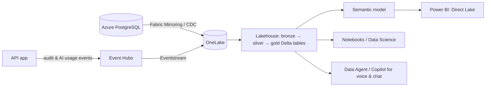

# Bonus 1 – Microsoft Fabric readiness

## Goal
Make operational data (customers, shipments, status history, chat usage) available for analytics and Power BI without loading the production database.

## Recommended architecture

## Data flow
1. **Mirroring / CDC (preferred)** – Mirror the PostgreSQL database into OneLake (or run an ADF/Fabric Data Factory pipeline with incremental copy keyed on `updatedAt` if mirroring isn't available for the server tier). The append-only `ShipmentEvent` table is the ideal change feed.
2. **Streaming path** – `shipment_status_changed` events already exist in the app; publishing them to Event Hubs lets an Eventstream land them in a KQL database for near-real-time monitoring.
3. **Lakehouse layers** – *bronze* raw mirrored tables; *silver* cleaned (soft-deleted rows flagged, enums decoded, UTC timestamps); *gold* star schema: `fact_shipment_event`, `dim_customer` (SCD2 on `status`/`company`), `dim_date`, `dim_route`.
4. **Semantic model** – Measures: shipments by status, on-time rate, average transit time (Pending→Delivered), cancellations, active customers. Power BI uses Direct Lake so reports stay fast without import refresh.
5. **Sales data** – CSV uploads from the analytics service can optionally be written to a `sales_uploads` Lakehouse folder so revenue by region/salesperson becomes a governed dataset instead of a one-off chart.

## Reporting possibilities
- Operations: status funnel, aging shipments, lanes with highest cancellation.
- Customers: shipment volume per customer, churn indicators (Inactive customers with recent volume).
- Sales: revenue by region over time, top salespeople, forecast notebooks.
- AI usage: questions asked per day, failure rate of the provider, top intents.

## Governance & security
Row-level security by customer segment/region, sensitivity labels via Purview, Entra groups mapped to Fabric workspace roles, PII (name/email) masked in `gold` unless the viewer is in a privileged group.

## Changes needed in this codebase
None blocking. Already in place: stable UUID keys, `updatedAt` on every table, soft delete (not hard delete, so CDC sees the change), append-only history. Nice-to-have: a `tenantId`/`region` column on `Customer` for RLS.
