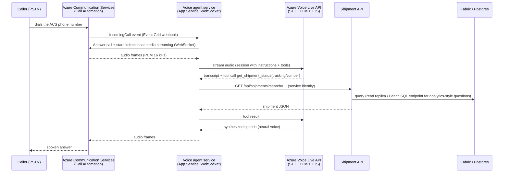

# Bonus 2 – Voice agent architecture

A caller asks "Where is shipment RBHU-3F2A9C1D00?" and hears the answer.

## Components
- **Azure Communication Services** – phone number, Call Automation (answer, transfer to a human, hang up), bidirectional audio streaming.
- **Azure Voice Live API** – single realtime session handling speech-to-text, the LLM turn and text-to-speech with barge-in (interruptions), noise suppression and end-of-turn detection. Alternative composition: Azure AI Speech STT → Azure OpenAI → Speech TTS, at the cost of more latency and glue code.
- **Voice agent service** – small Node service (can live in this repo as `voice/`) that bridges the ACS media WebSocket and the Voice Live session, and exposes *tools* to the model.
- **Tools (function calling)**
  - `get_shipment_status(trackingNumber)` → calls the existing API.
  - `get_open_shipments_for_customer(customerName)`.
  - `transfer_to_agent()` → ACS call transfer.
- **Fabric** – answers analytical questions ("how many shipments were delivered this week?") through a Fabric Data Agent or the SQL analytics endpoint over the gold tables.

## Key design points
1. **Identity**: caller is unauthenticated, so the agent only reveals shipment status after verifying a second factor (tracking number + last 4 digits of the customer's phone, or a DTMF PIN). Read-only tools; no mutation by voice.
2. **Tracking numbers by voice**: spoken IDs are error-prone. Use a phrase list/custom speech for the `RBHU-` prefix, read numbers back for confirmation, and fall back to "I'll text you the details".
3. **Latency target** < 1.2 s to first audio: keep tools to one API hop, cache status for 15 s, stream TTS.
4. **Safety**: system prompt limits scope to shipment queries, PII never read out in full, recordings off by default (consent announcement if enabled), full transcripts stored with retention policy.
5. **Resilience**: if Voice Live or the API is down, play a fallback message and offer transfer to a human queue.
6. **Observability**: call ID propagated as a request ID; metrics for answer rate, containment rate (resolved without a human), average handle time, tool error rate.
7. **Cost control**: max call duration, silence timeout, per-day budget alert.
